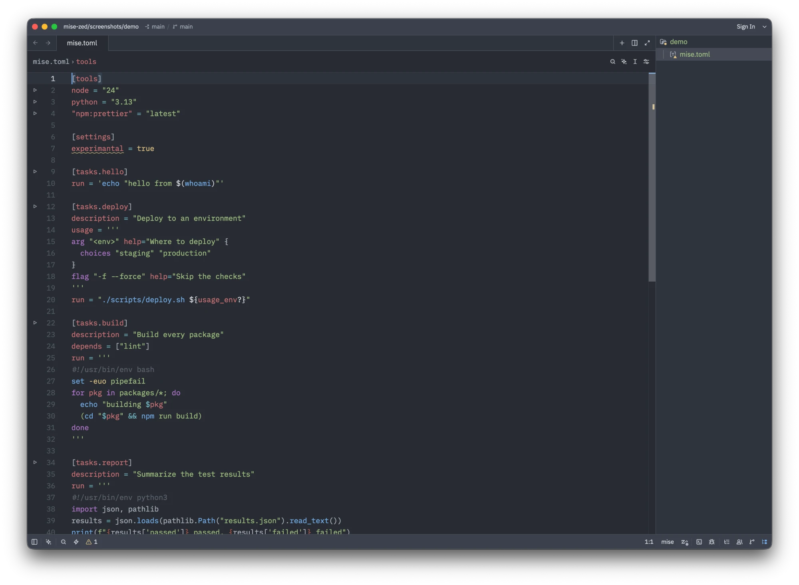
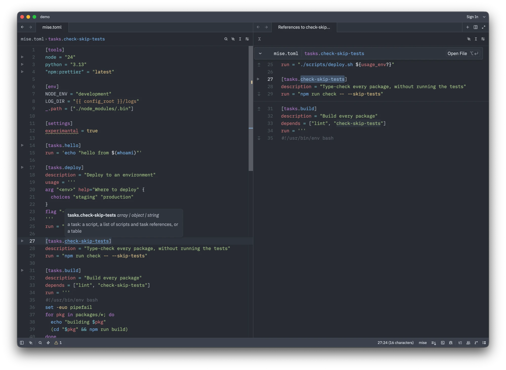
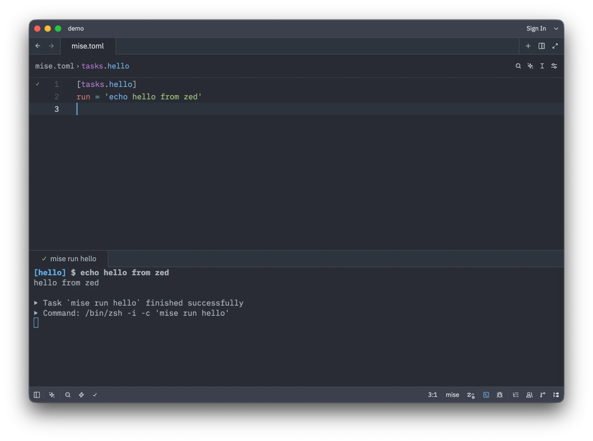

# mise-zed 🧑‍🍳

[Zed](https://zed.dev/) extension for [mise](https://mise.jdx.dev/) (`mise-en-place`). [Documentation](doc/)

> [mise](https://mise.jdx.dev/) is a polyglot tool version manager, environment
> variables manager, and tasks runner.

This Zed extension brings `mise` to your editor: diagnostics, completion and
quick fixes in `mise.toml`, run buttons for
[tasks](doc/tasks-and-tools.md) and [tools](doc/tasks-and-tools.md#tools),
and [snippets](doc/snippets.md). It also offers better syntax highlighting than a TOML extension
alone would provide.

> [!NOTE]
> The language server needs mise 2026.10.18 or later, which has
> [`mise lsp`](https://github.com/jdx/mise/releases/tag/v2026.10.18).

## Installation

The extension is not in the Zed extension registry [yet](https://github.com/zed-industries/extensions/pull/8073). To install it from
source:

1. Install Rust, which Zed uses to build the extension, with
   [rustup](https://rustup.rs/) or with mise: `mise use -g rust`.
2. Clone this repository.
3. In Zed, run `zed: install dev extension` from the command palette and pick
   the cloned folder.

Zed 1.24 or later is needed. The language server needs mise 2026.10.18 or
later; the rest works with any recent mise.

The extension comes with defaults that you might want to change. See
[Configuration](doc/configuration.md) for every setting.

## Features

### [mise.toml Language Support](doc/language-support.md)

- Syntax highlighting, outline and brackets for `mise.toml` files, with
  sections, task names, environment variables and Tera templates told apart
- Task scripts (`run`) highlighted as shell, or as Python or JavaScript
  from their shebang, and [usage](https://usage.jdx.dev/) specs
- Diagnostics: TOML syntax, unknown keys with a suggestion, wrong types,
  deprecated keys, unknown task names and dependency cycles
- Quick fixes to replace an unknown key or task name with the one mise
  suggests, and to rewrite a deprecated key
- Completion of keys (inline tables included), of values with a fixed set,
  such as booleans and enums, of task names in `depends` and `wait_for`, and
  of tool names from mise's registry
- Hover documentation for keys, tasks and tools
- Go to definition, find references and rename for tasks
- Formatting, as `mise fmt` does

### [Tasks](doc/tasks-and-tools.md)

- Run buttons on [mise tasks](https://mise.jdx.dev/tasks/) in `mise.toml`
- `mise run`, `mise install`, `mise doctor` and more in `task: spawn`

### [Tools](doc/tasks-and-tools.md#tools)

- Run buttons on [mise tools](https://mise.jdx.dev/dev-tools/) to install or
  upgrade them, in `mise.toml`
- Syntax highlighting and outline for `.tool-versions` files

### `mise.toml` is a `mise` file, not a TOML file

`mise.toml`, `.mise.toml`, `mise.local.toml`, `.config/mise/config.toml` and the
other common config files open as the `mise` language, highlighted as TOML.
TOML extensions such as [Tombi](https://zed.dev/extensions/tombi) leave them to
`mise lsp`, so diagnostics, completions and hovers are not doubled. See
[which files are `mise` files](doc/language-support.md#which-files-are-mise-files)
to map more files, or to keep one as TOML.

### `mise lsp` on other TOML files is opt-in

`mise lsp` is also registered for TOML, for config files such as
`mise/config.toml` or `conf.d/*.toml`, but it is off by default: it would
start in every Rust or Python project. See
[Configuration](doc/configuration.md#mise-lsp-on-toml-files) to turn it on.

### Semantic tokens are off in Zed

With mise 2026.10.19 or later, `mise lsp` also colors what the highlighting
cannot tell: tool names under `[tools]`, task names in `depends` and templates
inside `run` scripts. Zed asks for these semantic tokens only once you turn
them on: see [Configuration](doc/configuration.md#semantic-tokens).

### [Snippets](doc/snippets.md)

- `mise-task` snippets to create tasks in `mise.toml` and file tasks, and
  `mise-daemon` snippets to declare daemons in `mise.toml`

## [Documentation](doc/)

- [mise.toml language support](doc/language-support.md)
- [Tasks and tools](doc/tasks-and-tools.md)
- [AI agents (MCP)](doc/ai-agents.md)
- [Snippets](doc/snippets.md)
- [Configuration](doc/configuration.md)
- [Limitations](doc/limitations.md): what the
  [VS Code extension](https://github.com/hverlin/mise-vscode) does that this one
  cannot yet
- [Development](doc/development.md)

## Bug Reports / Feature Requests / Contributing

- Found a bug? Please
  [open an issue](https://github.com/hverlin/mise-zed/issues)
- Contributions are welcome! See [Development](doc/development.md) to build and
  try the extension.

## Ecosystem

- [mise-vscode](https://github.com/hverlin/mise-vscode), the VS Code extension
  this one follows
- See [intellij-mise](https://github.com/134130/intellij-mise) if you are
  looking for a similar plugin for IntelliJ IDEA
- [Mise documentation](https://mise.jdx.dev/)

## License

This extension is licensed under the MIT License. See the [LICENSE](LICENSE)
file for details. The TOML queries in `languages/mise` come from the
[TOML extension](https://github.com/zed-extensions/toml), under the Apache
License 2.0 ([LICENSE-APACHE](LICENSE-APACHE)), and `tree-sitter-mise-toml`,
`tree-sitter-mise-bash` and `tree-sitter-usage-kdl` are forks of
[tree-sitter-toml](https://github.com/tree-sitter/tree-sitter-toml),
[tree-sitter-bash](https://github.com/tree-sitter/tree-sitter-bash) and
[tree-sitter-kdl](https://github.com/tree-sitter-grammars/tree-sitter-kdl) (MIT).
